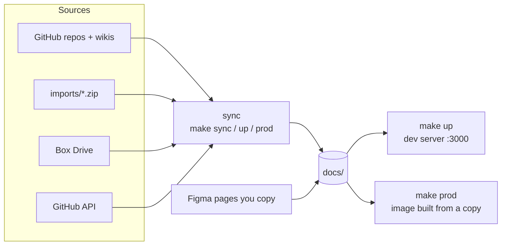

## Four kinds of content

| Kind | Examples | Committed? | Refreshed by |
|---|---|---|---|
| **Hand-written** | `docs/guides/`, `docs/intro.mdx` | Yes | Editing the file |
| **Pulled from GitHub** | `docs/blue-core-repos/`, `docs/blue-core-wiki/` | **No** | Every `make up`, `make prod`, `make sync` and GitHub Pages deploy |
| **Local only** | `docs/google-drive/`, `docs/box/`, `docs/design/` (Figma) | **No** | `make up` / `make prod` / `make sync`, from files on your machine |
| **Live** | Project board, Repo Issues, Integration Tests, What's New (`docs/project-status/`) | **No** | The browser, every 5 minutes. On the public site, the hourly deploy, without the private board. See [Live GitHub data](./live-github-data.md). |

Only hand-written pages are in git. Everything else is rebuilt on each machine from its source, and `.gitignore` covers every generated folder, so internal content can't be committed by accident.

Never edit generated pages. Each sync step rewrites its folder, so your changes would be lost. Change the source (repo, wiki, Drive or Box file) instead.

## Local-only sections

Google Drive, Box and Figma design notes exist only on machines that have the files:

| Section | Source on your machine | When it's missing |
|---|---|---|
| Google Drive | `.zip` downloads in `imports/shared-drive/` | The sync removes `docs/google-drive/` |
| Box | Box Drive folder set with `BOX_DIR` in `.env` | The sync removes `docs/box/` |
| Figma design notes | Pages you copy into `docs/design/` | Nothing to remove |

When a section is missing, the site shows no trace of it: no sidebar entry and no navbar or footer link. `docusaurus.config.js` checks which section folders exist when the site starts.

The sync converts Drive and Box files again only when they change. It compares names, sizes and modified dates with the `.source-stamp` file in the section folder. Run `SYNC_FORCE=1 make sync` to convert everything anyway, for example after changing a sync script.

## What each command does

| Command | Pulls from sources | Serves |
|---|---|---|
| `make sync` | **Everything**: Drive downloads, Box, GitHub repos and wikis, the Project Status snapshot, code docs, then `llms.txt` | Nothing. It only writes `docs/`. |
| `make box` | Box only | Nothing |
| `make up` | **Everything** (runs the sync first) | `docs/` with hot reload, plus MCP (:3001) and chat (:3002) |
| `make prod` | **Everything** (runs the sync first) | A **copy** of `docs/` baked into the images, served by nginx (:8080), plus `mcp-prod` (:3001) |

How long the sync takes:
- **First run:** several minutes, mostly converting the Drive export.
- **Later runs:** about 30 seconds for GitHub, while unchanged Drive and Box files are skipped.
- **When a source fails** (no network, expired token): `make up` and `make prod` print a warning and start with what's already in `docs/`.
- **To skip it:** `make up SYNC=0` (or `make prod SYNC=0`) starts right away with what's already in `docs/`. Use it for quick restarts.

## Syncing while the site is running

You can run `make sync` while `make up` is running. The sync runs in its own short-lived container that shares the project folder.

- **Dev site (:3000):** reloads when files change, polling once a second. While a step rewrites its folder, pages in that section can 404 or show errors for a moment. If something still looks wrong after the sync, restart with `make up`.
- **New or removed sections:** their navbar and footer links only change after a restart.
- **MCP server:** its search index rebuilds every 30 seconds, so agents and the chat see new content within about half a minute.
- **One sync at a time.** Two syncs write to the same folders and can leave a mix of files.

## `make prod` builds from a copy

`make prod` syncs, then builds two images from the folder as it is at that moment:

- **`web`** copies the project, runs `npm run build` (which regenerates `llms.txt` first) and serves the static HTML with nginx.
- **`mcp-prod`** copies `docs/` and `docs-sources.json` and serves MCP from that copy.

A later `make sync` doesn't change the running images. Run `make prod` again to publish new content. The live Project Status data is the exception: `mcp-prod` fetches it from GitHub, so it stays current without a rebuild.

:::warning
The `prod` images include your local-only content (Drive, Box, Figma, the private project board). Treat them as internal, and put a login in front of them if you share them (see "Sharing your local production site" in the README).
:::

## The public GitHub Pages site

`.github/workflows/deploy.yml` runs on every push to `main` and every hour. It:

1. pulls the GitHub repo docs and wikis (`npm run sync:readmes`), public repos only;
2. builds with `LIVE_API_URL=''` and `CHAT_API_URL=''`, so there is no live data and no chat box.

It also builds the Project Status pages with `PUBLIC_BUILD=1`, which leaves out the private project board. Drive, Box and Figma aren't on the CI machine, so the public site has no trace of them. The hourly run is how the public site picks up changes to repo docs and wikis.

## Which command do I need?

| I want to… | Run |
|---|---|
| See a change to a hand-written page | Nothing. `make up` hot-reloads it. |
| Restart quickly without re-pulling | `make up SYNC=0` |
| Pick up a changed README or wiki page | `make sync` (or restart `make up`) |
| Pick up a new Drive export | Replace the zips in `imports/shared-drive/`, then `make sync` |
| Pick up a changed Box file | `make box` |
| Add or remove the Figma design notes | Add or remove `docs/design/`, then restart `make up` |
| See a new project board or workflow | Add it to `docs-sources.json`, then `make sync` |
| Update my local production site | `make prod` |
| Update the public site | Push to `main`, or wait for the hourly deploy |

## Related

- [Live GitHub data](./live-github-data.md)
- [How these docs work](./writing-docs.md)
- `SETUP.md` in the repo root: first-time local setup
- `docs-sources.json`: every imported source
