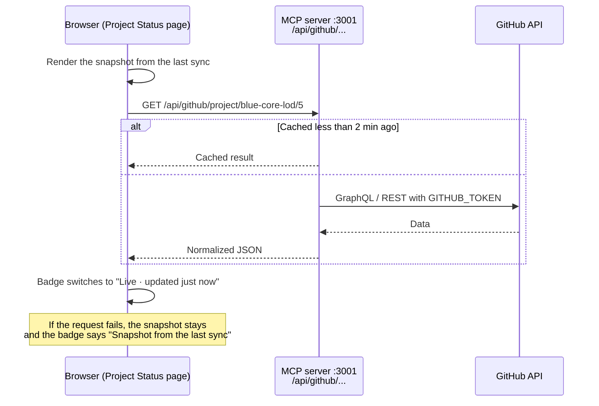

The **Project Status** pages (project board, Repo Issues, Integration Tests, What's New) show GitHub data that updates while you look at it. This page explains where that data comes from, how fresh it is, how to add a board or workflow, and what to check when a page says "Snapshot".

## How it works

Each page is built in two layers:

1. **A snapshot.** The sync (`npm run sync:status`, part of `make up`, `make prod` and `make sync`) fetches everything once and writes it to `docs/project-status/_data/*.json`, together with an `.mdx` page for each view.
2. **Live updates.** In the browser, the page starts with the snapshot, then asks the MCP server for fresh data and asks again **every 5 minutes**.



`GITHUB_TOKEN` stays in the MCP container. Browsers only receive the processed results, so the token never reaches a web page.

### The badge

Every Project Status page has a badge at the top:

- **Live · updated N min ago:** the last request to the MCP server worked.
- **Snapshot from the last sync · date:** the live request failed. **Hover over the badge** to see the error.
- **As of date:** this site has no live API (the public GitHub Pages site). The data is from the last deploy, which runs nightly.

### Freshness

| Layer | How long | Setting |
|---|---|---|
| Browser refresh | 5 minutes | `REFRESH_MS` in `src/components/ProjectStatus/shared.js` |
| Server cache | 2 minutes (failed requests aren't cached) | `LIVE_CACHE_SECONDS` |
| Snapshot | Until the next sync (`make up` / `make prod` / `make sync`) | n/a |

So live data is at most about 7 minutes old.

## The pages

All pages live under `/project-status`. Their settings are in the `projectStatus` block of `docs-sources.json`.

### Navigating between them

The sidebar shows **Project Status** as one link, to an overview page with a card for each page. Each page also has a row of icon links at the top:

| Icon | Page |
|---|---|
| Grid | Overview |
| Columns | Project board (local only) |
| Circle with a dot | Repo Issues |
| Flask | Integration Tests |
| Tag | What's New |

- **Tooltips:** hover over or tab to an icon to see what the page shows, with counts from the last sync. On phones only the icons are shown.
- **Where the links come from:** the sync writes them to `_data/nav.json`, so the row only lists pages this build has.
- **How the dropdown is hidden:** `customProps.hideItems` in the section's `_category_.json` and `sidebarItemsGenerator` in `docusaurus.config.js`.

### Public site vs. local

The GitHub Pages deploy runs the sync with `PUBLIC_BUILD=1`, which **leaves out project boards** because they're private. Repo Issues, Integration Tests and What's New are built from public repos and are on the public site, refreshed nightly. To publish a board that is public, add `"public": true` to its entry in `projects`.

### Project board (`projects`)

One page per GitHub Projects (v2) board, fetched with GraphQL.

- Shows a column per **Status** value, with counts per status at the top.
- Has filters for repo, assignee, label and text.
- Hides **Done** by default (use the "Show Done" checkbox).
- Cards show the repo and number, assignees, labels, milestone, sub-issue progress and parent issue.

```json
"projects": [
  { "org": "blue-core-lod", "number": 5, "slug": "blue-core-mvp-board" }
]
```

`number` is the number in the board's URL (`github.com/orgs/blue-core-lod/projects/5`). This needs the **`read:project`** token scope.

### Repo Issues (`issues`)

Open issues of every repo in the org, grouped by repo, with filters for repo, label and assignee. Repos are chosen by `includeArchived`, `includePrivate`, `includeForks` (`false`, `true` or a list of fork names) and `skipRepos`.

The same repo filter limits what the MCP GitHub tools may read, so private repos stay out even though the token can see them.

### Integration Tests (`integrationTests`)

Health of a GitHub Actions workflow. It's built for the `bluecore-stack` **Bluecore Integration Test** workflow, but works for any workflow that runs pytest.

| On the page | Where it comes from |
|---|---|
| Latest run, pass rate (all runs read, last 7 days, last 20 runs) | Run conclusions. Cancelled and skipped runs don't count. |
| Passing or failing streak | Consecutive equal results from the newest run |
| Median and p90 run time | Durations of successful runs |
| Tests (latest results) | pytest summary line from the job log |
| Time to fix | Median minutes from a failure to the next passing run |
| Last N runs chart | Duration and result of each run |
| Where failures happen | Failed step names grouped into Image build / Tests / Setup / Other |
| By trigger | Which repo's workflow dispatched the run (e.g. `api-integration`), or `push`, `schedule`, … |
| Most-failing tests | `FAILED` / `ERROR` lines from the pytest output, and whether each test still fails |
| Recent runs | Links to the runs on GitHub |

```json
"integrationTests": [
  {
    "org": "blue-core-lod",
    "repo": "bluecore-stack",
    "workflow": "bluecore-integration-test.yml",
    "title": "Bluecore Integration Test",
    "runs": 100,
    "parseLogs": 30
  }
]
```

| Key | Meaning |
|---|---|
| `workflow` | The workflow **file name** in `.github/workflows/` |
| `org` | Defaults to `issues.org` |
| `runs` | How many recent runs to read (max 100) |
| `parseLogs` | How many recent **passing** runs to download logs for. Logs of every failed run are always read. |
| `slug`, `pageTitle` | Optional page URL and title |

How logs are read:

- Test results are parsed from the log of the first failed job, or the first job if none failed. This assumes the tests run in a single job.
- GitHub keeps logs for 90 days by default, so older runs show results without test details.
- The MCP server keeps parsed logs in memory, starting from the snapshot. Each refresh downloads only logs of new runs, and the data is fetched once when the server starts so the first page view is fast.

### What's New (`releases`)

The latest release of each repo as "Latest versions" cards, then a release timeline (25 at a time, filterable by repo).

- Highlights are the first three bullet points of each release's notes.
- Draft releases are skipped.
- `perRepo` sets how many releases to read per repo.

## Where the live API is

| Where you run it | Page asks | Reaches |
|---|---|---|
| `make up` (dev, :3000) | `http://localhost:3001/api/github/...` | `mcp` container directly |
| `make prod` (:8080) | `/api/live/github/...` (same address) | nginx forwards to `mcp-prod:3001`, so it also works through ngrok |
| GitHub Pages | Nothing (`LIVE_API_URL=''`) | Data from the nightly deploy. The project board is left out (`PUBLIC_BUILD=1`). |

The page reads the address from `customFields.liveApiUrl` in `docusaurus.config.js` (set with `LIVE_API_URL`).

### Endpoints

All are `GET` only and served by `mcp/live-api.mjs`:

| Endpoint | Returns |
|---|---|
| `/api/github/project/<org>/<number>` | Board items. Only boards listed in `projects`. |
| `/api/github/issues/<org>` | Open issues per repo. Only `issues.org`. |
| `/api/github/releases/<org>` | Releases. Only `releases.org`. |
| `/api/github/ci/<org>/<repo>/<workflow file>` | Runs with parsed test results. Only listed workflows. |

Anything not in `docs-sources.json` returns 404, so the server can't be used to read arbitrary GitHub data. Safety checks:

- Requests must be addressed to `localhost` (or a host in `MCP_ALLOWED_HOSTS`).
- Browsers may read the responses only from `localhost` pages, `DOCS_SITE_URL` or `LIVE_ALLOWED_ORIGINS`.

Try it from a terminal while `make up` is running:

```bash
curl -s http://localhost:3001/api/github/project/blue-core-lod/5 | head -c 400
curl -s http://localhost:3001/api/github/ci/blue-core-lod/bluecore-stack/bluecore-integration-test.yml | head -c 400
```

## The same data for AI agents

The MCP tools `project_board`, `list_issues`, `list_releases` and `integration_tests` use the same cached data as the pages. When GitHub can't be reached they fall back to the snapshot and say so in their answer. Other GitHub tools (`get_issue`, `search_issues`, `ci_status`, `search_code`, `fork_changes`, …) call GitHub directly. The full list is in the repo `README.md`.

## Adding a board or workflow

1. Add the entry to `projectStatus` in `docs-sources.json`.
2. Run `make sync` to create the page and its snapshot. The page doesn't exist until a sync writes it.
3. **Dev:** the MCP server reads `docs-sources.json` on every request, so live data works right away. **Prod:** run `make prod` again, because `mcp-prod` has its own copy of the file.

The sync builds the whole section in a temporary folder and replaces `docs/project-status/` only if every fetch worked. If one fetch fails, you keep the old pages.

## Code map

| File | Role |
|---|---|
| `mcp/github.mjs` | Fetches and normalizes boards (GraphQL), issues, releases and workflow runs, and parses pytest logs. Used by the sync **and** the live API. |
| `mcp/ci-metrics.mjs` | Pass rate, streaks, durations, failure stages, triggers and most-failing tests. Pure functions used by the page text, the sync and the MCP tool. |
| `mcp/live-api.mjs` | `/api/github/...` endpoints, caching, the snapshot fallback for MCP tools, and the integration test log cache |
| `scripts/sync/project-status.mjs` | Writes the snapshot JSON and the `.mdx` pages, including a text version of each page for search |
| `src/components/ProjectStatus/` | React pages. `shared.js` has `useLiveData` (snapshot, then live, then refresh) and the badge. |
| `docker/nginx.conf` | `/api/live/` forwarding in prod |

## Troubleshooting

Hover over the "Snapshot" badge to see the error, then:

| Error | Fix |
|---|---|
| `GITHUB_TOKEN is not set in this container` | Add it to `.env` and restart (`make up` / `make prod`). |
| `Your token has not been granted the required scopes` / board errors | Run `gh auth refresh -s read:project`, put the new `gh auth token` in `.env` and restart. |
| `unknown project` / `unknown workflow` | The URL doesn't match `docs-sources.json`. In prod, rebuild with `make prod` after editing it. |
| `Failed to fetch` | The MCP server isn't running. Start `make up`, or `make mcp`. |
| `Host "…" not allowed` | Add the host name to `MCP_ALLOWED_HOSTS`. |
| Project Status section and Status link missing | No sync has run with a token yet. Run `make sync`, check its `project-status` log lines, then restart `make up` so the navbar link appears. |
| Test details missing for old runs | Their logs have expired on GitHub (90 days). |

## Related

- [How content gets onto the site](./content-lifecycle.md)
- `SETUP.md` in the repo root: getting a token with the right scopes
- `docs-sources.json`: the `projectStatus` block
