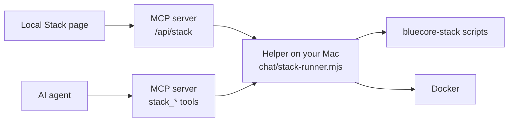

## Turn it on

The Local Stack pages are off by default, as Jupyter Notebooks are. They run scripts on your machine, so you turn them on yourself in the site's `.env`:

```bash
LOCAL_STACK=true
BLUECORE_STACK_DIR=/Users/you/Code/bluecore-stack
```

Then run `make up` (or `make prod`). While the setting is off, Workspace has no Local Stack item, the MCP server has no `stack_*` tools, and the helper refuses to run the scripts. The pages are never on the public site.

## What you can do

[Local Stack](/local-stack) is a set of pages, like Project Status. The overview has a card for each section that shows its current state. You switch between sections with the left sidebar, which shows live counts such as running services, running jobs and the last test result, or with the icons at the top of every page. On narrow screens only the icons show.

| Section | What it shows |
|---|---|
| **Services** | Every container of the stack with its state, health, ports and image, links to the stack's pages, Logs and Restart buttons, and the scripts that start, stop and reset the stack |
| **Logs** | One service's logs, followed live, filtered by time or text, with errors and warnings highlighted |
| **Tests** | The integration tests (pick all, a folder, a file or one test) and the workflow tests, with their recent runs |
| **Data** | Load data and Sinopia profiles, or clear them, with their recent runs |
| **Set up** | Install and update the sibling repos, and export or import the Keycloak realm |
| **Jobs** | Every script run, from these pages or by an agent, with its live output, exit code and a Stop button. **Remove** deletes a finished job; **Clear finished** removes every job that isn't running. |
| **Troubleshoot** | A check of Docker, your checkouts, every service and its recent errors, with a fix button for each problem, and the slow query watcher |

**Ask AI** buttons on the Logs, Jobs and Troubleshoot pages send the question to Ask the docs. The assistant then reads the same logs and jobs through its tools.

## The scripts

Each action runs one script from your bluecore-stack checkout, with its options checked first. The first column says which section has it:

| Group | Action | Runs |
|---|---|---|
| Services | Start the stack | `scripts/dev/run` (all of it, chosen services, core only, or the published images) |
| | Stop the stack | `scripts/dev/down` |
| | Restart a service | `docker restart <container>` |
| | Stop and delete all data | `scripts/dev/down --volumes` (asks first) |
| Set up | Install or repair | `scripts/dev/update-stack --install` |
| | Check for updates | `scripts/dev/update-stack --check` |
| | Update the repos | `scripts/dev/update-stack --merge` or `--rebase` (asks first, unless it's a dry run) |
| Data | Load data | `scripts/dev/load-data <url>` |
| | Load Sinopia profiles | `scripts/dev/load-profiles <remote>` |
| | Clear loaded data | `scripts/dev/clear-data --yes` (asks first) |
| Tests | Integration tests | `scripts/test/integration-tests.sh`: pick a folder, a file or one test from your checkout's `tests/`, optionally dev mode, `-k` and branches to build from |
| | Remove the dev-mode test stack | `scripts/test/integration-tests.sh --dev-mode-stop` |
| | Workflow tests | `scripts/test/workflow-tests.sh` (with act) |
| Set up | Export the realm | `scripts/export-keycloak-realm.sh` |
| | Import the realm | `scripts/import-keycloak-realm.sh` (asks first) |
| Troubleshoot | Watch slow query plans | `scripts/dev/database/explain --since <time>` |

**Start the stack** runs `scripts/dev/run` the way your terminal would. The job keeps running while the stack is up and shows every service's output. Stopping that job is like pressing Ctrl+C: Docker Compose stops the containers.

Jobs run in the background on your machine. They keep going if you close the page or restart `make up`.

## For AI agents

The MCP server has six tools over the same jobs. They're described in [Local stack tools](./mcp-tools/tools/local-stack.mdx).

- **Read-only tools:**
  - `stack_status`: services, health and jobs
  - `stack_logs`: a service's logs, with secret values redacted
  - `stack_diagnose`: the troubleshooting check
  - `stack_job`: a job's output
- **Tools that run scripts:**
  - `stack_run`: starts a script as a job
  - `stack_stop_job`: stops a running job

Ask the docs only runs a script when you ask it to. The actions that delete or rewrite data (`reset`, `clear_data`, `import_realm`, `update`) are refused unless the agent passes `confirm`, which it only does after you agree.

## How it works



The scripts need your Mac: Docker, `uv`, `act`, git and the sibling checkouts. So they run in the dashboard's helper on the host (`chat/server.mjs`, the one behind Ask the docs), which `make up` and `make prod` start.

The MCP server in Docker reaches the helper at `host.docker.internal:3002`, using a token the helper writes to `.devenv/token`. JupyterLab has no copy of that token, so notebooks can't run the scripts. Each job's command, output and exit code are kept in `.devenv/jobs/` (the last 100 jobs).

## Troubleshooting

| Problem | What to do |
|---|---|
| "The helper on this machine isn't reachable" | Start the site with `make up` or `make prod`, or run `make chat`. If it's running but older than the Local Stack page, restart it. |
| "Point the dashboard at your stack checkout" | Set `BLUECORE_STACK_DIR` in the dashboard's `.env` |
| A script says a command isn't found | The helper inherits the `PATH` of the terminal that ran `make`. Install the tool (`uv`, `act`), then restart `make up`. |
| The integration tests run out of memory | The full run builds a second stack next to your dev stack. Use dev mode, stop the dev stack first, or give Docker more memory. |

## Related

- [Jupyter Notebooks](./notebooks.md)
- [MCP tools](./mcp-tools/index.mdx)
- The [Bluecore Stack docs](/blue-core-repos/bluecore-stack/) for what each script does
